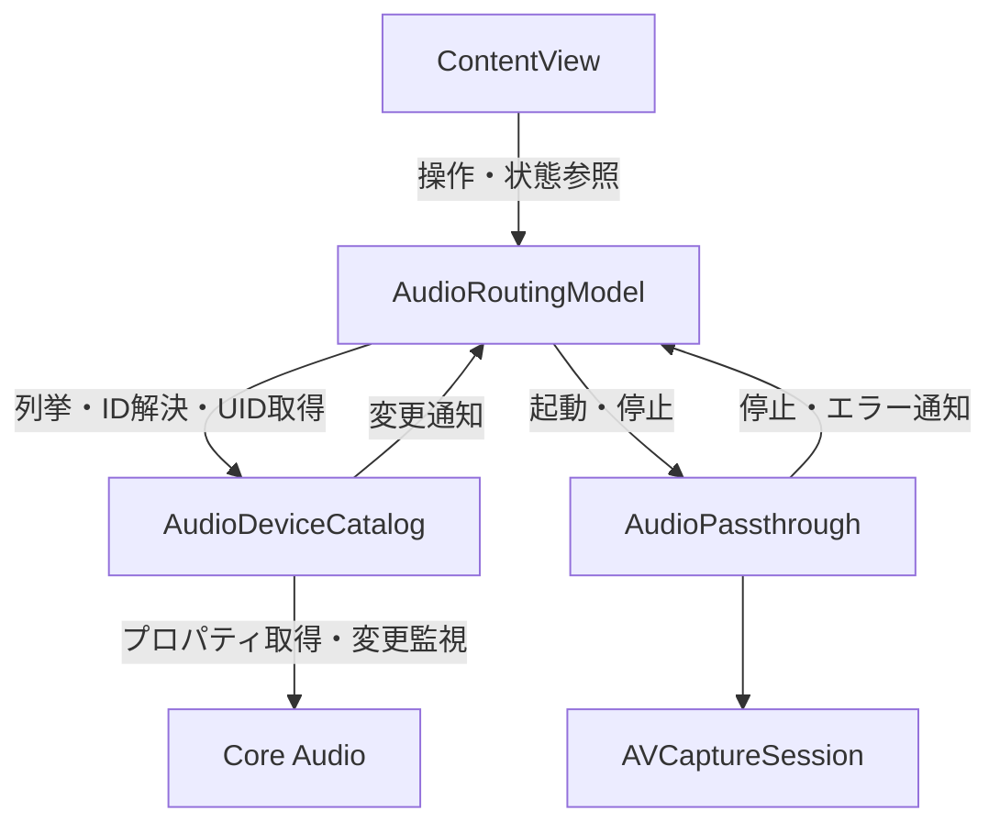

# Audio Penetrator 技術仕様・構成

現在のソースコードに基づき、構成と動作をまとめます。ビルド手順・利用手順は[README](README.md)を参照してください。

## 1. 概要

macOSの入力デバイスから受け取った音声を、選択した出力デバイスへ転送します。デバイス情報はCore Audioで取得し、音声の転送はAVFoundationの音声プレビュー機能に任せます。

| 技術 | 用途 |
| --- | --- |
| SwiftUI | ボタン、デバイス選択、選択中の経路の表示 |
| Observation | モデルの変更をUIへ反映 |
| Core Audio | デバイス一覧、名前、UID、デフォルトデバイスの取得と変更監視 |
| AVFoundation | マイク権限の確認、音声入力とプレビュー出力 |
| Swift Concurrency | UIと転送セッションの分離、起動・停止の順序制御 |
| OSLog | エラー理由の記録 |

## 2. ファイル構成と責務

ソースコードは`macos-audio-penetrator/`に配置しています。

| ファイル・型 | 責務 | 実行・状態管理 |
| --- | --- | --- |
| [macos_audio_penetratorApp.swift](macos-audio-penetrator/macos_audio_penetratorApp.swift) | `WindowGroup`で画面を生成 | SwiftUIのアプリ入口 |
| [ContentView.swift](macos-audio-penetrator/ContentView.swift) | 操作をモデルへ渡し、モデルの状態を表示 | `@State`でモデルを保持 |
| [AudioRoutingModel.swift](macos-audio-penetrator/AudioRoutingModel.swift) | デバイス選択、権限確認、転送の開始・停止・再構成 | `@MainActor`、`@Observable` |
| [AudioDeviceCatalog.swift](macos-audio-penetrator/AudioDeviceCatalog.swift) | デバイスの列挙、Defaultの解決、UID取得、監視 | `@MainActor` |
| [AudioPassthrough.swift](macos-audio-penetrator/AudioPassthrough.swift) | 転送セッションの構成、起動・停止、停止通知の処理 | 独立した`actor` |



モデルと転送セッションはウィンドウごとに保持します。アプリ全体で共有するシングルトンはありません。

## 3. 画面の状態

`AudioRoutingModel`が次の状態を保持します。

| プロパティ | 型・初期値 | 意味 |
| --- | --- | --- |
| `inputDevices` / `outputDevices` | `[AudioDevice]`、空配列 | 入力・出力それぞれの選択肢。初期化時に取得する |
| `selectedInputDevice` / `selectedOutputDevice` | `AudioDeviceID`、`0` | 選択中のID。`0`はDefaultを表す |
| `selectedInputName` / `selectedOutputName` | `String`、算出プロパティ | 選択中のIDに対応する表示名 |
| `isRunning` | `Bool`、`false` | UI上の起動要求。ボタン表示の切り替えに使用 |

`isRunning`はクリック直後に更新されます。`true`には権限確認中・起動処理中も含まれ、実際に音声が流れていることを保証する値ではありません。実セッションの起動結果は`AudioPassthrough`が`AVCaptureSession.isRunning`で確認し、失敗時はモデルを停止状態へ戻します。

起動・停止のTask、通知を識別する`revision`、一覧更新中のフラグは`@ObservationIgnored`とし、UIの観測対象から外しています。

## 4. デバイス取得とDefault

`AudioDevice`は`id: AudioDeviceID`と`name: String`を持ち、`Identifiable`・`Hashable`に準拠します。Pickerの選択にはIDを使うため、同名デバイスも別の選択肢として扱います。

一覧取得は次の順序です。

1. `kAudioHardwarePropertyDevices`からデバイスIDを取得する。
2. `kAudioDevicePropertyStreamConfiguration`を入力・出力それぞれのスコープで読み、チャンネル数が1以上のデバイスを抽出する。
3. `kAudioObjectPropertyName`から名前を取得し、`localizedStandardCompare`で並べる。
4. 各一覧の先頭に`Default (デバイス名)`を追加する。

| 情報 | Core Audioプロパティ |
| --- | --- |
| デフォルト入力 | `kAudioHardwarePropertyDefaultInputDevice` |
| デフォルト出力 | `kAudioHardwarePropertyDefaultOutputDevice` |
| AVFoundationへ渡すUID | `kAudioDevicePropertyDeviceUID` |

Defaultの選択IDには`kAudioObjectUnknown`（`0`）を使います。転送の起動・再構成のたびに`resolve(_:for:)`で現在のデフォルトIDへ解決し、`deviceUID(for:)`でUIDへ変換します。デフォルトが存在しない場合の表示は`Default (利用可能なデバイスなし)`です。

デバイス一覧・デフォルト入力・デフォルト出力の3プロパティを監視し、変更時はMainActorで一覧を更新します。選択中のデバイスが一覧から消えた場合は、その方向の選択をDefaultへ戻します。

起動要求が有効な間は、監視通知を受けるたびに転送を再構成します。明示的に選んだデバイスに直接関係しないデフォルト変更でも再構成します。個々のデバイスの名前やサンプルレートを直接監視する処理はありません。

## 5. 音声転送

音声データは次の経路を通ります。


入力UIDから`AVCaptureDevice(uniqueID:)`でデバイスを取得し、音声入力に対応していることを確認して`AVCaptureDeviceInput`を作成します。出力UIDは`AVCaptureAudioPreviewOutput.outputDeviceUniqueID`へ設定します。

プレビュー音量は`volume = 1`です。システム音量やデバイスの音量設定は変更しません。アプリ側でPCMバッファの受け渡しや加工を実装せず、音声形式の調整と転送はAVFoundationに任せます。

セッションの構成は`beginConfiguration()`と`commitConfiguration()`で囲み、`defer`でエラー時にも構成を終了します。`startRunning()`は構成終了後に実行します。

転送サービスの主なインターフェースは次のとおりです。

```swift
func start(
    inputUID: String,
    outputUID: String,
    onStop: @escaping @Sendable (String?) -> Void
) throws

func stop()
```

どちらも`AudioPassthrough`のactor内で実行します。外部からの呼び出しには`await`を使い、`start`は`try await`で扱います。`onStop`の文字列は停止理由で、通知にエラーが含まれない場合は`nil`です。

## 6. 起動・停止と並行処理

起動・再構成は`AudioRoutingModel.updateRouting()`で次の順に処理します。

1. 前のTaskをキャンセルし、新しい`revision`を発行する。
2. 前のTaskの完了を待ち、キャンセル済みの要求なら終了する。
3. 既存の転送セッションを停止する。
4. 起動要求が有効ならマイク権限を確認する。
5. 権限確認後に再度キャンセルを確認する。
6. 入出力のIDを解決し、UIDを取得して新しい転送セッションを起動する。

前のTaskの完了を待つことで、ボタン連打やデバイス切り替え時に古い起動処理が後から実行されることを防ぎます。`AudioPassthrough.start`にも、処理の入口と構成完了後にキャンセル確認があります。

停止要求ではUIの`isRunning`を先に`false`にし、同じ処理経路でセッションを停止します。同期APIの実行やマイク許可ダイアログ自体を途中で中断する実装はありません。許可待ち中に停止した場合は、ダイアログへの応答後にキャンセルを確認して起動を取りやめます。

UIとデバイス一覧はMainActorで管理し、ブロックする`startRunning()`・`stopRunning()`は別のactorで実行します。このactorは専用スレッドへの固定を意味しません。

## 7. 操作・通知ごとの動作

| 操作・通知 | 動作 |
| --- | --- |
| 「起動する」をクリック | 起動要求を有効にし、権限確認とセッション起動へ進む |
| 「停止する」をクリック | 起動要求を解除し、セッションを停止する |
| 停止中にPickerを変更 | 選択状態だけを更新する |
| 起動要求中にPickerを変更 | 既存セッションを停止して、選択した経路で再構成する |
| デバイス一覧・Defaultの変更 | 一覧と選択を更新し、起動要求中なら再構成する |
| `ContentView.onDisappear` | 転送を停止する |
| `runtimeErrorNotification` | セッションを停止し、停止理由をモデルへ通知する |
| `didStopRunningNotification` / `wasInterruptedNotification` | セッションを停止し、モデルを停止状態へ戻す |

デバイス接続解除時は、一覧変更とセッション停止の通知順によって転送が停止することがあります。Defaultへの選択復帰は行いますが、自動的な転送継続は保証しません。実行エラーや割り込み後の自動リトライはありません。

## 8. 通知とリソースの管理

`AudioPassthrough`はセッション単位で停止通知を登録します。通知処理ではセッションの`ObjectIdentifier`を比較し、過去のセッションから届いた通知を無視します。モデル側も`revision`を比較して、古い転送の通知が現在の画面状態を変更しないようにします。

通常の停止は、通知オブザーバーを解除してから`stopRunning()`を呼び、保持しているセッションを解放します。これにより、自分で停止した操作を予期しない停止として処理しません。`AudioPassthrough`の破棄時にも監視解除と停止を行います。

Core Audioのリスナーは内部の`AudioDeviceObservation`が管理し、監視停止時やヘルパーの破棄時に解除します。`onDisappear`で停止するのは音声転送であり、Core Audio監視の寿命はモデル側の保持に従います。

Core Audioから取得したCFStringは`takeRetainedValue()`で所有権を受け取ります。チャンネル情報の取得に使う`AudioBufferList`のメモリは、確保した処理内で`defer`により解放します。

## 9. 権限とエラー処理

マイク権限は`AVCaptureDevice.authorizationStatus(for: .audio)`で確認します。許可済みなら続行し、未決定なら`requestAccess(for: .audio)`を呼びます。拒否・制限されている場合は起動要求を解除してログを残します。

| 失敗箇所 | 処理 |
| --- | --- |
| デバイス一覧の取得・Defaultの解決・UID取得 | 停止状態へ戻し、エラーを記録 |
| Core Audioの監視登録 | エラーを記録。取得済みの一覧は保持 |
| マイク権限 | 停止状態へ戻し、設定の確認方法をログへ記録 |
| 入力デバイス取得・セッション構成・起動 | 停止状態へ戻し、エラーを記録 |
| セッションの停止・割り込み通知 | 停止状態へ戻し、エラー理由が含まれる場合に記録 |

ログは`Logger.error`を使用します。subsystemは`cyffon.macos-audio-penetrator`、categoryは`AudioRouting`です。理由の文字列は`privacy: .public`で記録します。エラーダイアログや画面上のエラー表示は実装していません。

## 10. プロジェクト設定と制約

| 設定 | 値 |
| --- | --- |
| Deployment Target | macOS 15.8 |
| Bundle Identifier | `cyffon.macos-audio-penetrator` |
| Swift言語モード | `5.0` |
| デフォルトのactor分離 | `MainActor` |
| Approachable Concurrency | 有効 |
| App Sandbox | 有効 |
| 音声入力へのアクセス | `ENABLE_RESOURCE_ACCESS_AUDIO_INPUT = YES` |
| マイク用途説明 | `NSMicrophoneUsageDescription`を生成Info.plistへ設定 |

上記はDebug・Release共通です。`SWIFT_VERSION = 5.0`は言語モードの指定であり、古いSwiftコンパイラへの対応を示しません。READMEに記載しているビルド確認環境はXcode 27.1です。

現在の実装では、サンプルレート・チャンネル数・バッファサイズ・遅延をアプリ側で指定していません。無遅延やビット単位で同一の転送を保証する仕様はなく、実機での転送・遅延・デバイス組み合わせは未確認です。Core Audioで一覧に出る入力でも、AVCaptureDeviceとして取得できない場合は起動エラーになります。

デバイス選択と起動状態の永続化、音声の録音・ファイル保存、ネットワーク転送は実装していません。画面を新しく生成した際の選択はDefault、起動状態は停止です。
